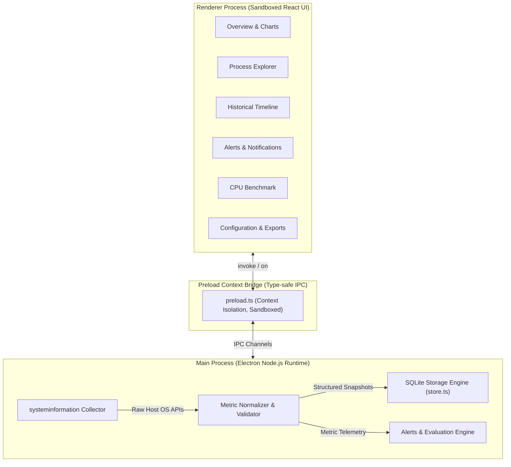

# TITAN Monitor Ultimate

[](https://github.com/Udaykiranjammula-alpha/titan-monitor-ultimate/actions/workflows/windows-build.yml)
[](https://github.com/Udaykiranjammula-alpha/titan-monitor-ultimate/releases)
[](LICENSE)
[]()

**TITAN Monitor Ultimate** is a local-first, privacy-focused Windows hardware diagnostics and performance monitoring desktop application. Built with modern Electron, React 18, TypeScript, and SQLite, it runs entirely on your local machine with zero analytics, zero telemetry collection, and no cloud dependencies.

---

## Key Highlights

- **Hardware Telemetry**: Real-time monitoring of CPU load, per-core utilization, clock frequency, RAM capacity and usage, drive allocation, and network throughput.
- **Accurate Windows Process Explorer**: Real-time resident memory (`WorkingSetSize`) correctly converted to bytes, provider CPU utilization down to `<0.01%`, and safe process inspection.
- **Local SQLite Historical Database**: All performance metrics and history are stored locally in SQLite with configurable retention periods.
- **Alert System**: Customizable alert thresholds for CPU, RAM, and storage with notification integration and hysteresis cooldowns.
- **CPU Benchmark**: In-app single-thread and multi-thread performance stress test and benchmark scoring.
- **Diagnostic Export**: One-click sanitizing export (JSON/HTML) of system metrics without personal identifiers or executable paths.
- **Zero Telemetry Guarantee**: No network calls outside your local machine.

---

## Architecture Overview



---

## Download & Installation

Visit the [Latest Releases](https://github.com/Udaykiranjammula-alpha/titan-monitor-ultimate/releases) to download:

- **Portable Executable**: `TITAN-Monitor-Portable-0.1.0-x64.exe` (run directly without installation)
- **Standard Windows Installer**: `TITAN-Monitor-0.1.0-x64.exe` (NSIS setup wizard with desktop & start menu shortcuts)

> **Note on Windows SmartScreen**: Binaries are compiled directly from source in public CI and are currently self-signed. Windows SmartScreen may display an initial warning on first launch. Click **More Info** → **Run anyway**.

---

## Development & Building from Source

### Prerequisites
- Windows 10/11 x64
- [Node.js](https://nodejs.org/) v22 or higher
- npm v10 or higher

### 1. Clone & Setup
```bash
git clone https://github.com/Udaykiranjammula-alpha/titan-monitor-ultimate.git
cd titan-monitor-ultimate
npm ci
```

### 2. Run in Development Mode
```bash
npm run dev
```

### 3. Build & Package Windows Executables
```powershell
# Build NSIS installer and Portable executable
npm run dist:win
```
Outputs are written to the `release/` directory.

---

## Test & Validation Suite

TITAN Monitor Ultimate enforces strict typing, linting, and regression tests:

```bash
# Run ESLint check
npm run lint

# Verify TypeScript compilation (Main + Renderer)
npm run typecheck

# Run Vitest test suite
npm test

# Production build bundle
npm run build

# Vulnerability scan
npm audit
```

All 12 unit and regression tests pass verifying:
- Correct resident memory byte calculations (`KiB * 1024` normalizer)
- Complete unit sequence formatting (`B` → `KB` → `MB` → `GB` → `TB` → `PB`)
- Small CPU fractional display rounding (`<0.01%`)
- Alert hysteresis and trigger intervals

---

## Documentation

Detailed technical documentation is available under `docs/`:
- [Architecture & Design](docs/ARCHITECTURE.md)
- [Hardware Compatibility & Fallbacks](docs/HARDWARE_COMPATIBILITY.md)
- [Windows Installation Guide](docs/INSTALL_WINDOWS.md)
- [Privacy Guarantee](docs/PRIVACY.md)
- [Security Model](docs/SECURITY.md)
- [Testing & Quality Assurance](docs/TESTING.md)
- [Troubleshooting & FAQ](docs/TROUBLESHOOTING.md)

---

## License

This project is licensed under the [MIT License](LICENSE) - see the [LICENSE](LICENSE) file for details.
